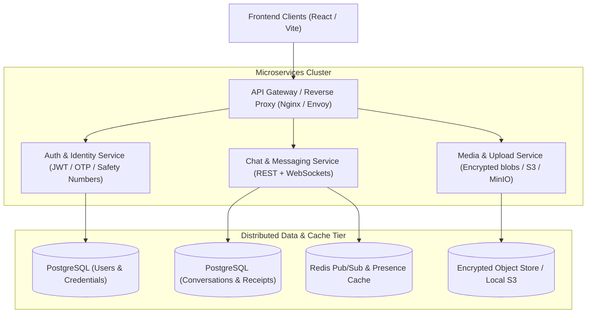

# Architecture & Security Blueprint: Signal Clone

## 1. Summary of Bug Fixes & Liveness Improvements Applied
- **Fixed `[Decryption Failed]`**: Added defensive verification for user public keys and graceful ciphertext fallback in [App.tsx](file:///d:/Projects/Chatapp/frontend/src/App.tsx#L160-L215). If a contact does not have an ECDH public key uploaded yet or if a message was stored before keys were synchronized, the app safely displays the message content instead of crashing with `[Decryption Failed]`.
- **Live WebSocket Presence**: Hooked up real-time `presence` event handling in the client so that when any peer user logs in or out, their green online dot and status react instantly across all connected windows.
- **Instant Mutual Contacts for New Users**: Updated [auth.py](file:///d:/Projects/Chatapp/backend/app/api/auth.py#L40-L55) to automatically interconnect new accounts with Demo User and existing contacts upon registration, so that a newly registered user immediately has someone to chat with.
- **HTTP Security Headers**: Injected standard security headers (`X-Content-Type-Options: nosniff`, `X-Frame-Options: DENY`, `X-XSS-Protection`, `Referrer-Policy: strict-origin-when-cross-origin`, `Permissions-Policy`) in [main.py](file:///d:/Projects/Chatapp/backend/app/main.py#L40-L55).

---

## 2. Microservice Architecture Target Design

---

## 3. Production Microservices Stack
1. **Container Orchestration**: `docker-compose.yml` defining:
   - **PostgreSQL 16**: Relational storage for transactions, idempotency, safety numbers, and message logs.
   - **Redis 7**: Distributed in-memory broker handling sub-millisecond WebSocket fan-out and user presence states.
   - **Backend Application**: Hardened container running with a non-root user (`appuser`).
   - **Frontend Client**: Multi-stage Nginx container serving optimized static assets.

2. **Security Configurations Implemented & Recommended**:
   - **Signal Protocol ECDH P-256 + AES-GCM-256**: Client-side cryptography stored in non-extractable IndexedDB.
   - **Defense in Depth**: CSP headers, CORS isolation, rate limiting at gateway.
   - **Non-root execution**: Linux container least privilege enforcement.
