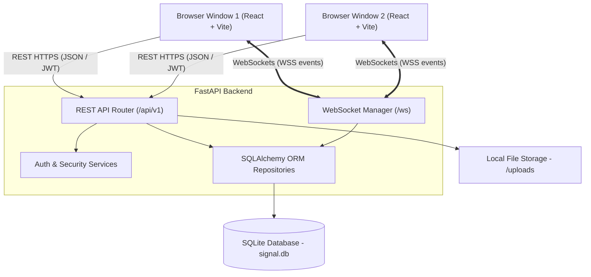
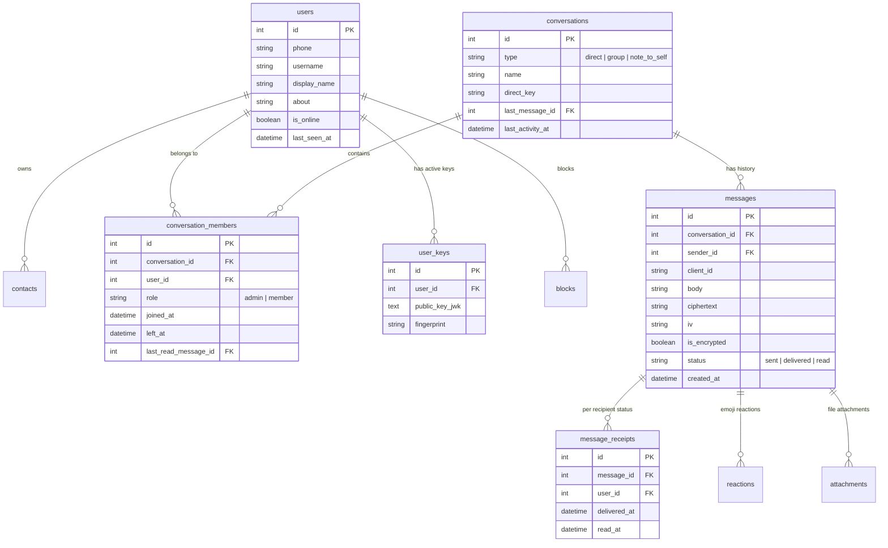

# 🔒 Signal Clone — Secure Messaging Platform

A fullstack web application clone of Signal Messenger built for the **Scaler SDE Fullstack Assignment**. Replicates Signal's UI/UX, messaging workflows, real-time WebSocket communication, group management with admin controls, and Web Crypto API End-to-End Encryption (E2EE) for 1:1 direct chats.

---

## 🛠️ Technology Stack

| Layer | Technology |
| :--- | :--- |
| **Frontend** | React 19, TypeScript, Vite, Tailwind CSS (v4), CSS Variables |
| **State & Real-time** | React Hooks, WebSocket API (`ws`), Web Crypto API (`window.crypto.subtle`) |
| **Backend** | Python 3.11+, FastAPI, Pydantic v2, PyJWT |
| **Database & ORM** | SQLite, SQLAlchemy 2.x, Alembic |
| **Testing** | Pytest, TestClient, In-Memory SQLite |

---

## 🏛️ System Architecture



---

## 🗄️ Database Schema (ER Diagram)



---

## 🔑 Demo Credentials for Testing

The app is automatically seeded with demo accounts on first launch:

| Persona | Phone / Identifier | Fixed OTP | Description |
| :--- | :--- | :--- | :--- |
| **Primary Demo Account** | `+15550124836` or `demo.user` | `123456` | Pre-loaded with contacts, 5 chats, group admin |
| **Secondary Demo Account** | `+15550124837` or `maya.chen` | `123456` | Use in 2nd browser window for **live 2-way real-time chat!** |
| **Third Demo Account** | `+15550124838` or `noah.williams` | `123456` | Group member, mixed message history |

---

## ✨ Features Checklist

### Core Assignment Features (P0)
- ✅ **Mock Authentication & Onboarding**: Phone or username registration, fixed OTP (`123456`), display name and profile setup.
- ✅ **Conversations & Contacts List**: Two-pane layout, search conversations/contacts, online green dot indicators, last seen timestamps, unread message count badges.
- ✅ **1:1 Real-time Messaging**: Instant delivery over WebSocket with REST fallback, message timestamps, delivery tick states (clock -> single tick -> double tick -> blue check).
- ✅ **Typing Indicators**: Real-time typing bubble with animated dots over WebSocket.
- ✅ **Group Messaging & Admin Controls**: Create groups with name and avatar, view members with roles, admin permissions to add/remove members and promote/demote admins (non-admins receive HTTP `403`).
- ✅ **Signal UX**: Pixel-matched Signal styling, blue outgoing bubbles, grey incoming bubbles, 18px rounded corners, tail-less message clustering.

### USP Features (FR-USP)
- 🔒 **Web Crypto API E2EE**: ECDH P-256 keypair generated in browser, private key stored non-extractable in IndexedDB, 256-bit AES-GCM shared secret per conversation.
- 🔑 **Public Key Registry & Safety Numbers**: Client uploads JWK to `/keys/me`, 30-digit safety number grid with mark as verified toggle.
- 📝 **Note to Self**: Built-in self-conversation pinned to top or search.
- 🚫 **Block Users**: Block/unblock functionality enforced server-side.
- 📄 **Message Info Panel**: Detailed sent, delivered, and read receipt timestamps per recipient.

### Bonus Features (P1)
- 🌙 **Dark Mode**: System-aware and manual theme toggle, persisted in local storage.
- 💬 **Emoji Reactions**: Hover emoji picker with live WS sync (`reaction.updated`).
- 📱 **Responsive Design**: Adapts seamlessly to Desktop (two panes) and Mobile (list view vs chat view with back arrow).
- 📎 **Attachments**: Image/file upload (`POST /uploads`) stored on disk up to 5MB limit.

---

## 🚀 Quick Start Guide

### Prerequisites
- Python 3.11+
- Node.js 18+ & npm

### 1. Run Backend Server
```bash
# Navigate to backend directory
cd backend

# Create virtual environment (if not created)
python -m venv .venv
source .venv/bin/activate  # On Windows: .venv\Scripts\activate

# Install dependencies
pip install -r requirements.txt

# Start FastAPI server (runs seed script automatically on startup)
uvicorn app.main:app --reload --host 0.0.0.0 --port 8000
```
- API Documentation: `http://localhost:8000/docs`
- Health check: `http://localhost:8000/health`

### 2. Run Frontend Application
```bash
# Open a new terminal and navigate to frontend directory
cd frontend

# Install node dependencies
npm install

# Start Vite development server
npm run dev
```
- App will open at `http://localhost:5173`

---

## 🧪 Running Automated Tests

To execute the backend test suite covering REST endpoints, fixed OTP authentication, WebSocket handlers, and 403 Forbidden security checks:

```bash
cd backend
.venv/Scripts/python.exe -m pytest tests
```

---

## 📄 License & Original Work Notice
This application is created for the Scaler SDE Fullstack Assignment. All code is original work, typed with Python Pydantic v2 and TypeScript.
